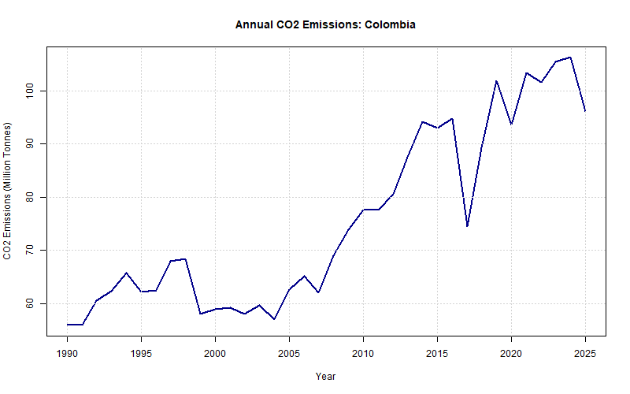
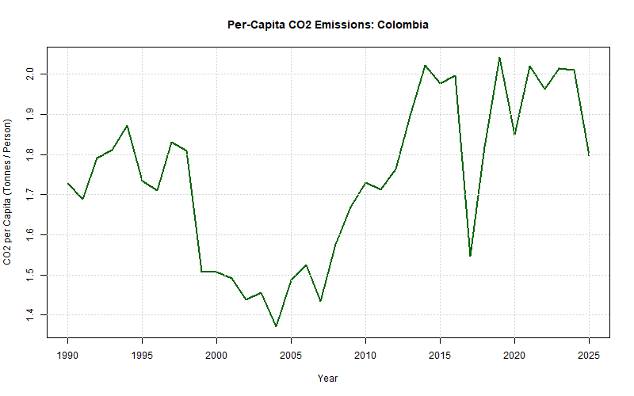
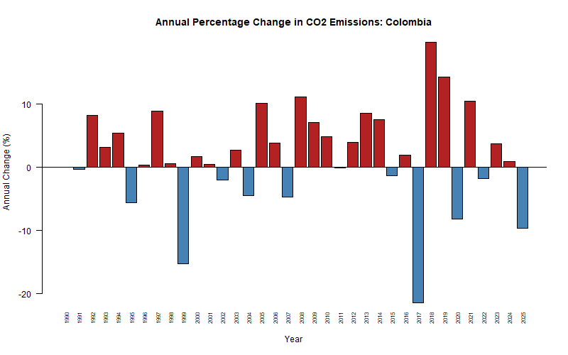

# CO2 emissions analysis: Colombia

*Student:* Miel Alexin B. Corporal  
*Country / ISO-3:* Colombia / COL  
*Study period:* 1990 to 2025  
*Declared to instructor on:* November 14,2026
## Research question
How have annual CO2 emissions and per-capita emissions changed in Colombia?

## Data source and definitions
Our World in Data (OWID) CO2 and Greenhouse Gas Emissions dataset.
- Dataset: https://github.com/owid/co2-data
- Downloaded on: November 14, 2026. Selected columns: year, co2, co2_per_capita.
- co2 is million tonnes per year; co2_per_capita is tonnes/person/year.

## How to reproduce the analysis
1. Install R, RStudio, and Git. Open this repository as an RStudio Project.
2. Use an internet connection for the first full CSV download.
3. In the RStudio Console, run:
   source("scripts/analyze_co2.R")
4. Inspect data/, figures/, and results/.

## Results
- Earliest / latest valid years: 1990 and 2025.
- Annual emissions in those years: 56.06 million tonnes (1990) and 96.07 million tonnes (2025).
- Endpoint percentage change: 71.36 %.
- Peak emissions year: 2024 (106.29 million tonnes).
- Latest available per-capita value: 1.80 tonnes/person (1.798 tonnes/person in 2025).

## Interpretation
Between 1990 and 2025, Colombia’s annual fossil-fuel and industrial $\text{CO}_2$ emissions rose from 56.06 million tonnes to 96.07 million tonnes, representing a 71.36% overall increase[span_6](start_span)[span_6](end_span)[span_7](start_span)[span_7](end_span)[span_8](start_span)[span_8](end_span). Emissions peaked in 2024 at 106.29 million tonnes before declining by 9.62% in 2025[span_9](start_span)[span_9](end_span)[span_10](start_span)[span_10](end_span). While absolute emissions expanded substantially over the 35-year period, per-capita emissions showed a much flatter trajectory, shifting only slightly from 1.73 tonnes per person in 1990 to 1.80 tonnes per person in 2025, with a trough of 1.37 tonnes per person in 2004[span_11](start_span)[span_11](end_span)[span_12](start_span)[span_12](end_span)[span_13](start_span)[span_13](end_span). This divergence indicates that population growth absorbed much of the aggregate emissions expansion, keeping individual emissions intensity relatively stable.

A sustained upward trend occurred from 2007 to 2014, during which annual emissions climbed steadily from 62.06 to 94.17 million tonnes[span_14](start_span)[span_14](end_span)[span_15](start_span)[span_15](end_span). Conversely, 2017 marked the sharpest single-year contraction in the dataset, when emissions dropped by 21.42% (from 94.73 to 74.44 million tonnes) before rebounding by 19.85% in 2018[span_16](start_span)[span_16](end_span)[span_17](start_span)[span_17](end_span). Because Colombia relies heavily on hydropower for electricity generation, fluctuations in rainfall—such as post-El Niño hydrological recovery around 2017—can reduce the need for backup fossil-fuel thermal generation (International Energy Agency [IEA], 2023), though observational data alone cannot prove single-factor causation.

Tracking national emissions trajectories is vital for evaluating climate mitigation commitments and anticipating ecological pressures on tropical biodiversity and hydrological cycles. However, territorial $\text{CO}_2$ accounting excludes emissions from land-use change and deforestation—major drivers of Colombia’s total greenhouse gas profile—as well as embodied carbon in traded goods.

## Limitations
- *Territorial accounting:* Only emissions generated within Colombia's national borders are counted, excluding embodied emissions from imported or exported goods.
- *Exclusion of land-use change:* The OWID co2 metric reflects fossil fuels and industry only, omitting deforestation, agriculture, and other greenhouse gases.
- *Cross-country comparisons:* Differences in economic structure, population size, and hydropower reliance limit direct comparisons between countries without broader socioeconomic context.

## References
- Our World in Data. CO2 and Greenhouse Gas Emissions data. https://github.com/owid/co2-data
- International Energy Agency (IEA). (2023). Colombia 2023: Energy Policy Review. IEA Publications. https://www.iea.org/reports/colombia-2023
